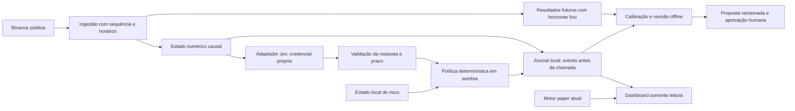

# Arquitetura V2 — experimento de IA em observação

Estado: ARQUITETURA APROVADA pelo usuário em 20/10/2026 para avanço ao plano. Especificação aprovada pelo usuário em 20/10/2026. Documento de projeto, não implementação executável. A sessão atual, sua identidade e seus parâmetros permanecem intactos. Não houve instalação de AgenKit, conexão Jev, contratação ou alteração de credenciais.

## 1. Decisões principais

Evolução incremental, com um observador novo ao lado do motor existente. Não tornar Jev dependência do motor atual. Nenhuma chamada do modelo escreve na carteira, remove STOP, propõe alteração de arquivos ou aciona funções de broker. Uma fase futura de negociação fictícia terá saldo e journal próprios; jamais reutilizar a sessão atual.

O analista é uma interface de pesquisa/revisão, não um modelo fixo pelo texto do prompt. Jev fornece julgamentos tipados, não verdade de mercado. Motor de estado, política, risco e auditoria são determinísticos. O fluxo em sombra não emite ordens, nem mesmo fictícias.

## 2. Fluxo e fronteiras

Não existe seta de P para O. O observador só lê metadados permitidos do motor atual; não controla suas posições. CoinGecko e pesquisa macro entram em relatórios de contexto separados, com fonte e disponibilidade; não substituem bid/ask executável da Binance.

## 3. Processos e permissões

| Componente proposto | Entradas | Saídas e credenciais |
| --- | --- | --- |
| Collector V2 | GET/WebSocket públicos em hosts fixos | Eventos locais; sem chaves Binance |
| State engine | Eventos e ledger em sombra | Snapshot numérico versionado; sem rede |
| Jev worker | Snapshot aprovado e perguntas fixas | Resposta validada; apenas TYPESAFE_API_KEY |
| Policy/risk | Snapshot, resposta e estado de bloqueios | HOLD/INELEGÍVEL/REVISÃO/CANDIDATO; sem broker |
| Review | Journal fechado e resultados observados | Relatório/proposta; sem chaves e sem escrita em configuração ativa |
| Dashboard | Resumos locais expurgados | Visualização; sem chave Jev, prompts externos ou transação |

O iniciador V2 deve criar ambientes de subprocesso com allowlist; não herdar todas as variáveis do processo pai. Binance API/secret, Telegram, CoinGecko e Jev ficam restritos ao processo que precisa deles. O observador não precisa de chave Binance. O launcher atual ainda herda o ambiente: isso é uma diferença a corrigir apenas na implementação revisada, não uma propriedade já existente.

Processos sob o mesmo usuário não são uma fronteira forte de segurança. Permissões de sistema operacional, usuário dedicado ou contêiner são necessários para isolamento contra processo comprometido; não alegar que classes Python, vários agentes ou pastas diferentes garantem isolamento. Instalação do harness não recebe credenciais de trading. Não tornar o painel acessível na internet para conectar um agente remoto.

## 4. Componentes, caminhos e contratos

Todos os caminhos abaixo são relativos à raiz de desenvolvimento:
C:/Users/Tayson/.codex/.chatgpt-projects/g-p-6ad2cfa25d9c8191b5ffdae7fa012911/work/bottrading

| Caminho planejado | Responsabilidade |
| --- | --- |
| ai_shadow/contracts.py | Validação estrita, números finitos, enumerações, versões e hashes |
| ai_shadow/collector.py | Eventos públicos, snapshot/updates, reconexão e sequência |
| ai_shadow/state.py | Cálculo causal de features e validade |
| ai_shadow/jev_client.py | Host fixo, timeout, autenticação, parser e métricas |
| ai_shadow/policy.py | Combinação explícita dos julgamentos; sem efeito de execução |
| ai_shadow/risk.py | Veto determinístico, limites persistentes e estados de revisão |
| ai_shadow/journal.py | Persistência transacional, unicidade, hashes e recuperação |
| ai_shadow/calibration.py | Eventos futuros elegíveis, Brier, baseline e cobertura |
| ai_shadow/review.py | Sumário noturno e proposta de revisão, nunca autoaplicada |
| ai_shadow_run.py | CLI futuro --paper --observe-only e supervisão |
| experiments/ai_shadow_plan.json | Plano novo, congelado antes de coletar avaliação |
| tests/test_ai_shadow_*.py | Matriz causal, isolamento lógico, limites, falhas e replay |

Esses módulos ainda não existem. A integração no iniciar.py e dashboard.py só ocorre depois dos gates de build/review. O comando futuro não deve aparecer como instrução operacional executável antes de existir.

## 5. Dados e relógios

Evento local mínimo: schema_version, source, venue, symbol, event_kind, exchange_sequence, event_at_ms quando fornecido, received_at_utc_ms, received_monotonic_ns, connection_epoch e conteúdo numérico.

O instante de decisão é congelado antes de selecionar entradas. Somente eventos recebidos até esse instante são elegíveis; usar event_at histórico sem received_at não simula acesso causal. Persistir o evento antes de confirmar uso, preservar ordem local e não reordenar silenciosamente sequências de exchange. Eventos futuros, atraso excessivo, relógio fora do limite ou incoerência de sequência invalidam a avaliação. Não fabricar timestamp de exchange quando a mensagem não o fornece: usar null e declarar que a idade é medida localmente.

A documentação atual do bookTicker e o tipo de feed precisam ser fixados no plano. BookTicker com tamanhos permite imbalance apenas do melhor nível. Profundidade completa exige outro coletor com snapshot+diff e validação de sequência; a V2 não deve chamar um imbalance de nível 1 de “order book completo”.

Features iniciais:
- mid=(bid+ask)/2 e spread relativo=(ask-bid)/mid, sem usar último negócio como preço executável;
- imbalance_l1=(bid_qty-ask_qty)/(bid_qty+ask_qty), quando ambos forem válidos; tipo explícito e nenhuma alegação de fluxo tóxico a partir desse valor;
- volatilidade realizada: desvio padrão de log-retornos na frequência/janela congelada, com mínimo de observações e cobertura; não anualizar por padrão;
- inventário e métricas de risco em frações normalizadas, lidos de ledger consistente e com horário;
- causal_window_start/end, coverage, gaps e validade fora do payload compacto, no envelope local completo.

O payload compacto terá códigos numéricos documentados; seu envelope contém par, versão, hash e os horários. Hash deve cobrir payload e envelope relevante. A contagem de tokens depende do tokenizer/usage efetivo. Sem comprovação de limite inferior a 400 tokens, a afirmação não é certificada. Não truncar silenciosamente limites de risco para caber no orçamento. Toda informação transmitida deve ser previamente aprovada no gate do plano.

## 6. Perguntas e respostas

Um request contém estado compartilhado e perguntas independentes: regime, direction, toxic_flow, setup_quality e risk_state. Cada pergunta precisa de rubrica testável a partir dos campos disponíveis. A falta de fonte para avaliar toxic_flow invalida essa avaliação, em vez de inventar false. Se o estado estritamente numérico não sustentar a pergunta, simplificar o objetivo ou propor novos dados no gate do plano; não inserir rumores como números confirmados.

Preservar response_model resolvido, schema_hash, probabilidades completas, confidence e usage. Validar soma das probabilidades, domínios, limites, chaves esperadas e consistência entre opção escolhida e distribuição. Não arredondar score para superar setup_quality>=2. Noul não é bool antes do limiar explícito aprovado. Não usar confidence como p de retorno lucrativo.

Acrescentar, somente se aprovado no plano, uma pergunta separada sobre o evento de retorno líquido em 60 minutos; sem probabilidade desse evento, não calcular Brier de lucratividade. Brier de regime é outro alvo e deve ser reportado separadamente.

## 7. Máquina de estados e política

BOOT -> CONFIG_VALIDATED -> WARMUP -> OBSERVING.
OBSERVING -> DATA_BLOCKED em dados antigos/lacuna/ausência de campo obrigatório.
OBSERVING -> CIRCUIT_OPEN após três falhas consecutivas do serviço.
OBSERVING -> REVIEW_REQUIRED por crise ou confiança<0,60.
Qualquer estado -> STOPPED quando STOP estiver acionado.
REVIEW_REQUIRED não desaparece por um simples reinício; requer aprovação registrada. CIRCUIT_OPEN permite canário após 60s, sem liberar sinais até dados e resposta válidos. STOPPED não é sinônimo de posições liquidadas.

Toda avaliação em sombra produz decisão persistida, inclusive WARMUP, timeout, bloqueios, ausência de setup e neutral. O modelo não recebe função de execução. `short` em Spot é inelegível como nova exposição; só pode se tornar proposta de reduzir inventário em uma futura política revisada. Nesta fase não há essa redução.

A porta candidata exige simultaneamente qualidade>=2, direction confidence>0,80, risco auxiliar safe, toxic_flow=false, estado válido, prazo e orçamento válidos E veto determinístico liberado. É “candidata em sombra”, não ordem ou estratégia validada.

Risco determinístico permanece autoritativo. Limites propostos da especificação: 15% de drawdown travado, 3% de perda diária, 25%/5 USDT na entrada e uma posição. Base diária UTC persiste; mudar fuso ou reiniciar processo não reinicia perdas. Integridade desconhecida do ledger bloqueia candidatos. STOP bloqueia todas as ordens do eventual executor; não anunciar garantia de stop de preço. Kelly permanece desabilitado, independentemente de confidence ou score.

## 8. Chamadas, orçamento e falhas

Default: provider_enabled=false e orçamento monetário zero. Só fixtures locais até ativação no gate do plano. Não reutilizar a chave CoinGecko como Jev ou inserir chaves no navegador/Git. O fornecedor é api.typesafe.ai, em HTTPS e endpoint documentado; não aceitar host arbitrário de notícia ou resposta. Não seguir redirecionamento com cabeçalho de credencial para outro host.

Um request por decision_id, sem execução paralela duplicada. Conjunto de pares pode ser enfileirado; uma chamada com múltiplas perguntas não deve ser confundida com estados diferentes compartilhando perguntas como se fossem um só estado. Tamanho máximo, concorrência e frequência serão congelados no plano.

Registrar custo previsto e reservar orçamento antes da chamada; reconciliar usage depois. Sem preços/configuração confiáveis, bloquear. Timeout não prova que o provedor deixou de processar/cobrar: guardar REQUEST_OUTCOME_UNKNOWN e não reenviar automaticamente o mesmo decision_id. Orçamento conservador reserva também tentativas de resultado desconhecido. Backoff nunca libera uma decisão antiga; coleta posterior produz outro decision_id.

Timeout proposto: 2s, com métricas de ponta a ponta e cancelamento local. Após resposta, revalidar idade do estado e book; se exceder limite, persistir RESPONSE_TOO_LATE e HOLD, mesmo que confidence alta. Fonte indisponível não é substituída automaticamente por preço agregado CoinGecko. Nenhuma latência de 81ms é prometida.

## 9. Persistência e recuperação

Escolha proposta: SQLite local, WAL, synchronous=FULL, um escritor e transações curtas. Não criar dependência de serviço de banco externo para 20 USDT. Retenção inicial proposta: 30 dias de eventos selecionados para a janela de avaliação, com limite de disco e política arquivável a aprovar no plano. Se faltar disco ou falhar uma escrita durável, bloquear novas avaliações externas; não continuar sem journal.

Tabelas lógicas:
- sessions(session_id, plan_hash, code_hash, model_pin, mode, started_at, state);
- events(event_id único, sequence, horários, payload_hash, payload permitido);
- decisions(decision_id único, candle_close, snapshot_hash, input_cutoff, gate_result, rejection_reason);
- requests(request_id, decision_id, schema_hash, budget_reservation, phase, latency, model, usage);
- predictions(decision_id, target_id, probability, predicted_at, eligible_after);
- labels(decision_id, target_id, evidence_hash, outcome, status);
- reviews(review_id, session_id, schema_proposed_hash, approval_state).

decision_id=hash(session_id, plan_hash, symbol, candle_close, schema_hash). Unicidade transacional antes da rede; atualização final após resposta. Raw data permitido e hashes ficam locais, nunca expostos integralmente ao painel. Hash detecta divergência de conteúdo; não é assinatura de fornecedor, carimbo de tempo externo ou prova contra alteração por usuário com acesso ao disco.

No reinício: abrir apenas a sessão com mesmo plano/código/modelo; verificar integridade e bloqueios; requisições pendentes tornam-se resultado desconhecido, não ordens pendentes; refazer WARMUP; preservar previsão anterior ao resultado. Mudança de versão exige nova sessão com referência ao journal anterior. Não resetar carteira nem sobrescrever registros para “corrigir” performance.

## 10. Rotulagem, calibração e pesquisa

O target financeiro de 60 minutos só será congelado no plano após definir entrada, saída e custos. Proposta de execução-sombra: primeiro ask válido observado depois da decisão elegível, bid próximo de entry_at+60min dentro de tolerância explicitamente aprovada, taxa e slippage por lado. Retorno líquido>0 define y=1. Sem quote elegível em qualquer ponta, OUTCOME_MISSING; sem preenchimento presumido. Essa rotulagem não equivale a uma estratégia de alvo/stop intrajornada e não pode calibrar Kelly dessa estratégia por substituição.

Separar: julgamentos de direção, confiança do fornecedor, probabilidade do evento e PNL de uma estratégia. Não agregar “acertos” de regimes com negócios lucrativos. Medir Brier versus probabilidade constante estimada só no treino e baseline sem sentimento/modelo. Comparação temporal deve remover sobreposição do horizonte entre treino e avaliação. Reportar amostra, cobertura e resultados ausentes antes de médias.

Pesquisa dos 5–10 setups será uma entrega da fase PLAN, com fontes primárias datadas e ausência de dados explícita. Nenhum ativo é considerado finalista pela arquitetura. Unlocks, TVL, receita/fees, concentração e captura de valor exigem fontes e definições específicas; não preencher campo faltante com opinião do modelo. Muitos testes e seleção retrospectiva permanecem riscos, mesmo com banco e harness.

## 11. Revisão noturna, monitoramento e publicação

Revisão noturna proposta: gerar pacote local por dia UTC com cobertura, falhas, latência, orçamento, distribuição das perguntas, candidatos, etiquetas maduras e calibração. O pacote pode propor nova rubrica; o hash ativo não muda. Modelo pesado só recebe evidência expurgada depois de orçamento e transmissão aprovados. Sem provedor, gerar sumário determinístico sem simular que houve releitura por IA.

Dashboard: aba V2 explicitamente “observação, sem ordens”, sem misturar saldo de 20 USDT do motor atual com candidatos V2. Mostrar último evento, idade, cobertura, circuit breaker, latência e custos com a unidade e a janela. Telegram opcional só envia avisos da V2 ao chat já configurado; volume e duplicação serão testados, sem notificações de compra para meros candidatos em sombra.

Publicação inicial: local, sem internet inbound, sem novo login de corretora, sem migração da sessão atual. Rollback: parar observador e manter motor atual; journal preservado para análise. 24/7 em nuvem requer arquitetura operacional própria, gestão de chaves, backups e orçamento; não é entregue automaticamente por um processo local.

## 12. Threat model resumido

| Risco | Controle a implementar | Limite residual |
| --- | --- | --- |
| Instrução maliciosa em notícia/post | Conteúdo não confiável, fontes identificadas, analista sem ferramentas de execução | Uma tese pode ser falsa mesmo em JSON válido |
| Resposta Jev semanticamente errada | Modo sombra, validação, rubricas, calibração e veto determinístico | Nenhuma garantia de edge |
| Chave em logs/URL/filho errado | Cabeçalho, redaction, env allowlist, host fixo | Mesmo usuário de SO ainda pode acessar memória/arquivos |
| Ordem duplicada após retry/restart | Nenhum executor V2; IDs e transações; sem retry cego | API externa pode cobrar timeout |
| Atraso/lacuna | Horários causais, idade e ressincronização | Falta de coleta não pode ser reconstruída retroativamente |
| Regressão do modelo | Modelo resolvido/versionado, hash de rubrica e plano | Mudanças no provedor exigem verificação |
| Backtest bonito por seleção | Registro de variantes, holdout, dados novos e custos | Histórico limitado e sobrevivência do universo |
| Autoaperfeiçoamento muda risco | Proposta offline e aprovação antes de ativar versão | Revisão humana também pode falhar |

## 13. Matriz de aceitação para orientar o build

Testes futuros devem demonstrar: evento recebido após cutoff não entra no estado; dados futuros/antigos e gaps bloqueiam; book incompleto não vira imbalance 0; 400 tokens não é alegado por comprimento em caracteres; API malformada/timeout/high-confidence inválida resulta HOLD; risco local prevalece sobre safe; short não cria exposição; Kelly não é calculado; dia UTC não reseta no restart; duplicata de evento não cria segunda chamada; uso desconhecido conserva reserva de orçamento; crash antes/depois de commit preserva fases; falha Jev/SQLite/disco não muda o motor atual; modelo não pode executar instruções vindas de texto; revisão não autoaplica rubrica; Brier não usa confidence; intervalos de resultado faltantes são excluídos e contados; painel distingue a V2 do saldo paper existente.

## 14. Pendências e gate

Necessário antes do plano com fornecedores ativos: licença AgenKit configurada localmente OU autorização explícita para processo equivalente sem o produto; escolha e teto de custo dos provedores; aprovação da transmissão dos campos do snapshot à TypeSafe; confirmação de disponibilidade de API/modelo. Não enviar chaves no chat. Nenhuma compra ou criação de conta foi realizada.

Aprovação requerida nesta etapa: fronteiras, persistência, modo em sombra, política de causalidade, risco proposto, latências propostas e revisão sem autoaplicação. Depois disso vem o plano detalhado com pesquisa e casos de teste, ainda sujeito ao próximo gate. Não houve build nesta fase.

## WHAT COULD I BE WRONG ABOUT?

Um estado compacto pode não conter informação suficiente para as perguntas. O modelo pode ser consistente, rápido e bem tipado sem prever retorno. Uma janela de 60 minutos pode não representar o risco de um alvo/stop. O limite de 2s pode ser inviável em conexão doméstica. Dados públicos de book não reproduzem fila e execução. O diário pode estar incompleto por falha de disco. Chamadas e nuvem podem custar mais que a vantagem de um capital de 20 USDT. Não há engenharia que transforme ausência de edge em lucro garantido.
